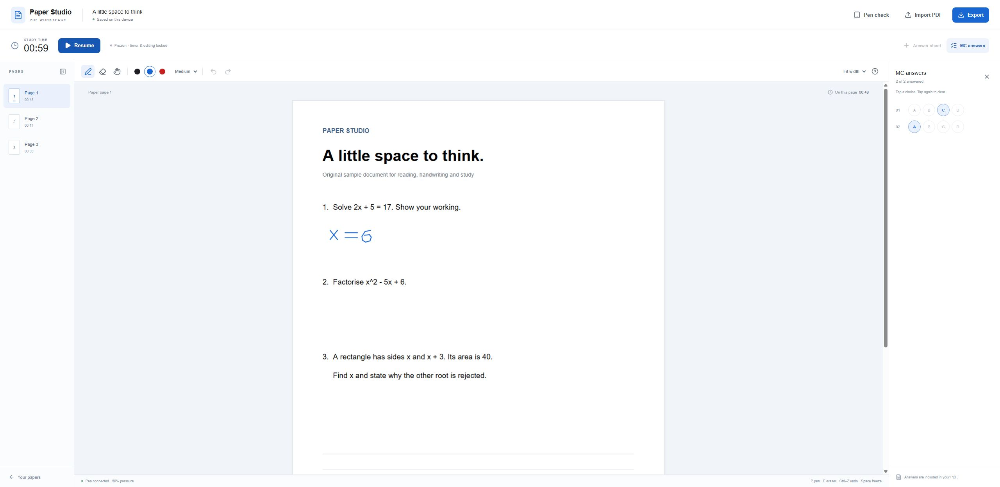

# Paper Studio

**A PDF study workspace with handwriting, optional timers and portable exports.**

[English](README.md) · [繁體中文](README.zh-Hant.md) · [Open the app](https://aseawa.github.io/paper-studio/)

[](https://github.com/aseawa/paper-studio/actions/workflows/ci-pages.yml)
[](LICENSE)

Paper Studio gives exam papers, worksheets, textbooks and research papers a shared place for reading and handwritten study. Import a PDF, select your timing preference, and write with a digital pen or mouse. Export an annotated PDF and structured study data when you are ready to review your work.



## Features

- Handwriting on the original PDF, with three pen widths, three colours, whole-stroke erasing, undo and redo.
- A stopwatch by default, a countdown for timed practice, and a timing-off mode for reading and annotation.
- Total and per-page active time, with a Freeze button that pauses timing and locks editing.
- Extra answer sheets for longer responses and optional single-answer MC grids with 2–6 choices.
- Annotated PDF export, a structured study report and an editable backup.
- Browser storage and protection against simultaneous edits in multiple tabs.
- Optional HKDSE 2026 timing presets and support for legacy `.dse.json` backups.

## Use the app

1. Open the [public demo](https://aseawa.github.io/paper-studio/) in a current desktop Chrome or Edge browser, or in Safari or Chrome on iPadOS 18 or later.
2. Choose **Import PDF**, enter a document name and select **Stopwatch**, **Countdown** or **Off**. Open **Paper options** to configure an MC grid.
3. Open the PDF, press **Start**, and write. Use **Pen check** to inspect the input reported by your pen driver.
4. Press **Freeze** to pause. You can browse pages while editing is locked. Press **Resume** to continue.
5. Choose **Export** to save your work.

| Export          | Contents                                                                     | Typical use                                 |
| --------------- | ---------------------------------------------------------------------------- | ------------------------------------------- |
| Annotated PDF   | Original pages, handwriting, added sheets, MC responses and a study report   | Share or review your work                   |
| Study-data JSON | Timing mode, page times, MC selections, preset provenance and session events | Send together with the PDF to a study agent |
| Editable backup | Original PDF, editable ink and saved study state                             | Continue on another browser or device       |

The PDF also contains an embedded `study-data.json` attachment. A separate JSON download makes the data accessible to tools that read the document pages only.

### Controls

| Action               | Shortcut                                 |
| -------------------- | ---------------------------------------- |
| Pen                  | `P`                                      |
| Whole-stroke eraser  | `E`                                      |
| Move paper           | `H`                                      |
| Undo                 | `Ctrl+Z`                                 |
| Redo                 | `Ctrl+Shift+Z` or `Ctrl+Y`               |
| Previous / next page | `←` / `→`                                |
| Freeze / resume      | `Space`, when focus is outside a control |

Pressure is used when the browser and pen driver provide it. Fixed-pressure pen and mouse input also work. Finger touches are excluded from ink input.

## Timing and storage

The displayed page accumulates time while a session is running. Frozen, hidden-tab and closed-app time is excluded. A scheduling gap longer than five seconds freezes the session and excludes that uncertain interval. Resuming is explicit. A countdown locks editing at its limit, and **Continue in overtime** records additional practice time.

MC timestamps record cumulative active study time at selection. Page times record time viewing a page. Timing-off exports use `null` for unrecorded timing fields.

Documents, handwriting and study records are stored in IndexedDB in the current browser, profile and website address. Exported files are generated in the browser. An editable backup is the transfer mechanism between the public demo, a self-hosted copy and another device. Save a backup before clearing browser storage.

The app accepts unlocked PDFs up to **150 MB and 500 original pages**. It supports up to **1,000 pages including answer sheets**. MC grids support **1–200 questions**, a configurable first number and one answer per question. Password-protected PDFs need an unlocked copy. PDF form editing, OCR, automatic marking and digital-signature preservation require other workflows.

HKDSE presets are grouped by examination year. Check the imported paper’s cover and adjust the duration for its year or extra time. Presets cite the [HKEAA assessment frameworks](https://www.hkeaa.edu.hk/en/hkdse/assessment/assessment_framework/).

## Run locally

Use Node.js **24** for the same environment used in CI. Node.js 22.13 or later satisfies the declared runtime minimum.

```sh
git clone https://github.com/aseawa/paper-studio.git
cd paper-studio
npm ci
npm run dev
```

Open the local URL printed by Vite. PDF worker, CMap, font and WASM assets are copied automatically before development and builds.

```sh
npm run check
npm test
npm run build
npm run preview
```

`npm run build` produces the static `dist` directory. Serve it with an HTTP server for self-hosting. Vite preview provides a local check of the build.

### Deploy under a subpath

Set `PAPER_STUDIO_BASE` to the site’s path before building. The GitHub Pages workflow uses `/paper-studio/`. Root hosting uses `/` by default. PDF resources follow the same base path.

```sh
# POSIX shell
PAPER_STUDIO_BASE=/paper-studio/ npm run build
```

```powershell
$env:PAPER_STUDIO_BASE = '/paper-studio/'
npm run build
```

## Project structure

```text
src/
  App.tsx                 Workspace and import/export interface
  components/             Handwriting surface, PDF rendering and dialogues
  lib/                    Session model, timing, storage, presets and PDF export
scripts/                  PDF asset preparation
tests/                    Timing, migration, storage and PDF regression checks
.github/workflows/        Windows/Linux checks and Pages deployment
```

The application uses React, TypeScript, Vite, PDF.js, pdf-lib and Lucide. The static app processes study documents in the browser.

## Compatibility and contributions

Version 2 upgrades existing version-one records and accepts `.dse.json` backups. Legacy sessions retain countdown timing. New backups use `.paperstudio.json`, and study reports use the `paper-studio.study-report.v2` schema. The internal database namespace is retained for existing installations.

The CI workflow checks a clean install, TypeScript, tests and production builds on Windows and Linux. A successful `main` run publishes the public demo. See [CONTRIBUTING.md](CONTRIBUTING.md) for the development process and [CHANGELOG.md](CHANGELOG.md) for release notes.

## Licence

Paper Studio is released under the [MIT licence](LICENSE). Third-party components retain their own licences and notices, listed in [THIRD_PARTY_NOTICES.md](THIRD_PARTY_NOTICES.md).
