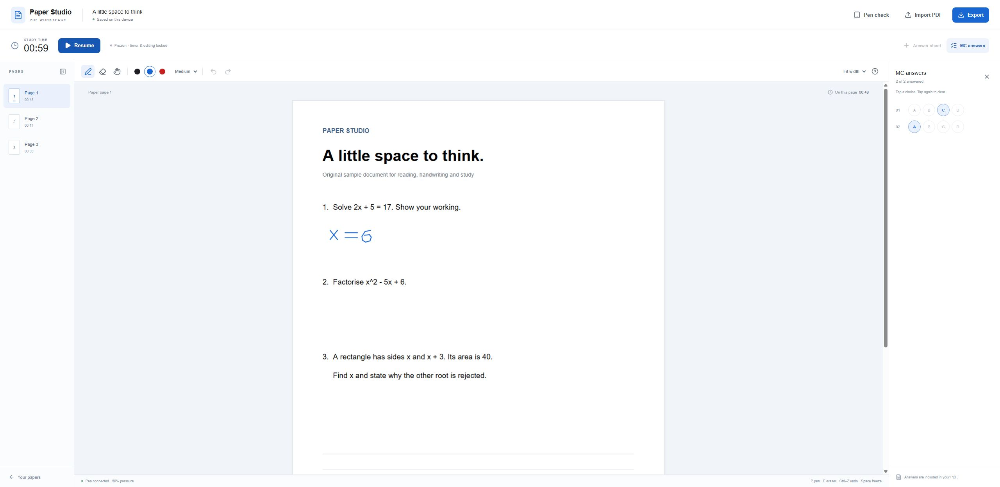

# Paper Studio

**支援手寫批註、可選計時模式及可攜式匯出的 PDF 學習工作台。**

[English](README.md) · [繁體中文](README.zh-Hant.md) · [開啟應用程式](https://aseawa.github.io/paper-studio/)

[](https://github.com/aseawa/paper-studio/actions/workflows/ci-pages.yml)
[](LICENSE)

Paper Studio 為試卷、工作紙、教科書及研究論文提供同一個閱讀與手寫學習空間。匯入 PDF、選擇計時方式，即可使用數碼筆或滑鼠書寫。完成後可匯出批註 PDF 及結構化學習資料，方便複習、分享或交給學習代理分析。



## 功能

- 直接在原始 PDF 上手寫，提供三種筆寬、三種顏色、整筆擦除、復原及重做。
- 預設使用正向計時，亦可選擇限時練習用的倒數計時，或關閉計時。
- 記錄總學習時間及每頁的實際使用時間，Freeze 按鈕可暫停計時並鎖定編輯。
- 可新增答題紙，並按需要啟用單選答案格，每題支援 2–6 個選項。
- 可匯出批註 PDF、結構化學習報告及可編輯備份。
- 資料保存在瀏覽器，並防止多個分頁同時修改同一份文件。
- 提供可選的 HKDSE 2026 計時預設，兼容舊版 `.dse.json` 備份。

## 使用方法

1. 使用新版桌面 Chrome 或 Edge 開啟[公開示範](https://aseawa.github.io/paper-studio/)。
2. 按 **Import PDF**，輸入文件名稱，並選擇 **Stopwatch**（正向計時）、**Countdown**（倒數計時）或 **Off**（關閉計時）。如需選擇題答案格，可展開 **Paper options**。
3. 開啟 PDF 後按 **Start**，即可書寫。**Pen check** 可顯示筆驅動程式回報的輸入類型及壓力。
4. 按 **Freeze** 暫停。編輯鎖定期間仍可瀏覽頁面，按 **Resume** 繼續。
5. 按 **Export** 儲存成果。

| 匯出格式      | 內容                                                   | 常見用途               |
| ------------- | ------------------------------------------------------ | ---------------------- |
| 批註 PDF      | 原始頁面、手寫內容、新增答題紙、選擇題答案及學習報告   | 分享或檢視作答         |
| 學習資料 JSON | 計時模式、逐頁時間、選擇題答案、預設來源及工作階段事件 | 連同 PDF 交給學習代理  |
| 可編輯備份    | 原始 PDF、可繼續編輯的筆跡及學習狀態                   | 在另一瀏覽器或裝置繼續 |

PDF 內亦附有 `study-data.json`。另外下載的 JSON 方便只會讀取 PDF 頁面的工具使用。

### 操作與快捷鍵

| 操作           | 快捷鍵                         |
| -------------- | ------------------------------ |
| 筆             | `P`                            |
| 整筆橡皮擦     | `E`                            |
| 移動頁面       | `H`                            |
| 復原           | `Ctrl+Z`                       |
| 重做           | `Ctrl+Shift+Z` 或 `Ctrl+Y`     |
| 上一頁／下一頁 | `←`／`→`                       |
| 暫停／繼續     | 焦點位於控制項以外時按 `Space` |

當瀏覽器及筆驅動程式提供壓力資料時，應用程式會使用壓感。固定壓力的筆或滑鼠亦可書寫，手指觸碰不會產生筆跡。

## 計時及儲存

工作階段進行時，時間只會累計到目前顯示的頁面。暫停、隱藏分頁及關閉應用程式的時間均不計算。若排程間隔超過五秒，應用程式會暫停工作階段，並排除該段無法確認的時間，需手動繼續。倒數時間用盡後會鎖定編輯，按 **Continue in overtime** 可記錄額外練習時間。

選擇題時間戳記代表選取答案時的累計學習時間，逐頁時間代表瀏覽該頁的時間。關閉計時時，匯出資料中未記錄的時間欄位會使用 `null`。

文件、筆跡及學習紀錄保存在目前瀏覽器、使用者設定檔及網站位址所屬的 IndexedDB，匯出檔案亦由瀏覽器產生。公開示範、自行部署版本及其他裝置之間，可透過可編輯備份轉移資料。清除瀏覽器資料前，請先儲存備份。

匯入支援已解鎖、最大 **150 MB、500 頁原始頁面**的 PDF。連同新增答題紙，文件最多可有 **1,000 頁**。選擇題答案格支援 **1–200 題**、可設定起始題號，每題選取一個答案。受密碼保護的 PDF 需先提供解鎖版本。PDF 表格編輯、OCR、自動評分及數碼簽署保留需使用其他工作流程。

HKDSE 計時預設按考試年份分類，請核對所匯入試卷的封面，並按年份或額外作答時間調整。預設附有[香港考試及評核局評核架構](https://www.hkeaa.edu.hk/en/hkdse/assessment/assessment_framework/)來源。

## 在本機執行

使用 Node.js **24** 可與 CI 環境一致，宣告的最低執行版本為 Node.js 22.13。

```sh
git clone https://github.com/aseawa/paper-studio.git
cd paper-studio
npm ci
npm run dev
```

開啟 Vite 顯示的本機網址。開發及建置前會自動準備 PDF worker、CMap、字型及 WASM 資源。

```sh
npm run check
npm test
npm run build
npm run preview
```

`npm run build` 會產生靜態網站目錄 `dist`，可透過 HTTP 伺服器自行部署。Vite preview 可用於本機檢查建置結果。

### 部署到子路徑

建置前將 `PAPER_STUDIO_BASE` 設為網站路徑。GitHub Pages 工作流程使用 `/paper-studio/`，根目錄部署預設使用 `/`，PDF 資源亦會使用相同基底路徑。

```sh
# POSIX shell
PAPER_STUDIO_BASE=/paper-studio/ npm run build
```

```powershell
$env:PAPER_STUDIO_BASE = '/paper-studio/'
npm run build
```

## 專案結構

```text
src/
  App.tsx                 工作台及匯入／匯出介面
  components/             手寫畫布、PDF 顯示及對話框
  lib/                    工作階段、計時、儲存、預設及 PDF 匯出
scripts/                  PDF 資源準備
tests/                    計時、遷移、儲存及 PDF 回歸檢查
.github/workflows/        Windows／Linux 檢查及 Pages 部署
```

應用程式使用 React、TypeScript、Vite、PDF.js、pdf-lib 及 Lucide，靜態網站直接在瀏覽器處理學習文件。

## 兼容及參與開發

第 2 版會升級現有第 1 版紀錄，亦接受 `.dse.json` 備份。舊工作階段會保留倒數計時設定，新備份使用 `.paperstudio.json`，學習報告使用 `paper-studio.study-report.v2` 結構。內部資料庫名稱繼續沿用，以兼容現有安裝。

CI 工作流程會在 Windows 及 Linux 執行全新安裝、TypeScript 檢查、測試及正式建置。`main` 的檢查通過後會發布公開示範。開發流程見 [CONTRIBUTING.md](CONTRIBUTING.md)，版本紀錄見 [CHANGELOG.md](CHANGELOG.md)。

## 授權

Paper Studio 使用 [MIT 授權](LICENSE)。第三方元件保留各自的授權及聲明，詳見 [THIRD_PARTY_NOTICES.md](THIRD_PARTY_NOTICES.md)。
